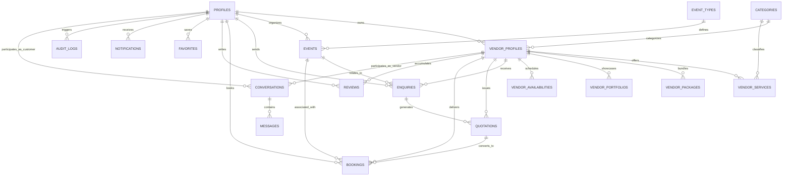

# WedConnect - Database Architecture & Entity Relationship Diagram

WedConnect uses Supabase PostgreSQL with strict Row Level Security (RLS), UUIDs on every table, soft delete support, audit logging, and automated triggers.

## Entity Relationship Diagram (ERD)

## Schema Entities Summary

1. **profiles**: Extends `auth.users`, manages profile info and 5 system roles (`visitor`, `customer`, `vendor`, `admin`, `super_admin`).
2. **vendor_profiles**: Rich vendor business details, location (city, state, lat/long), ratings, badges, verification status.
3. **categories**: Wedding & event vendor categories (Venues, Photography, Catering, Decor, Bridal Makeup, Music/DJ, etc.).
4. **event_types**: Supported event typologies (Wedding, Reception, Engagement, Sangeet, Birthday, Corporate).
5. **vendor_services**: Individual vendor offerings and prices.
6. **vendor_packages**: Packaged tier offerings (e.g. Silver, Gold, Platinum Luxe).
7. **vendor_portfolios**: High-resolution gallery and media showcase items.
8. **vendor_availabilities**: Calendar slot management (available, booked, blocked).
9. **events**: Customer planned event specifications, guest counts, budgets, and dates.
10. **enquiries**: Customer enquiry requests sent to matched vendors.
11. **quotations**: Formal itemized quotes with tax, validity period, and pricing sent by vendors.
12. **bookings**: Confirmed bookings with unique references, milestones, and status transitions.
13. **conversations & messages**: Real-time communication channels between customer and vendor.
14. **reviews**: 5-star ratings, testimonials, and vendor responses.
15. **favorites**: Customer bookmarking and shortlist mechanism.
16. **notifications**: In-app notifications with deep-links and read states.
17. **audit_logs**: Immutable trace of all admin and critical system actions.
18. **platform_settings**: Dynamic platform settings managed by Super Admins.

